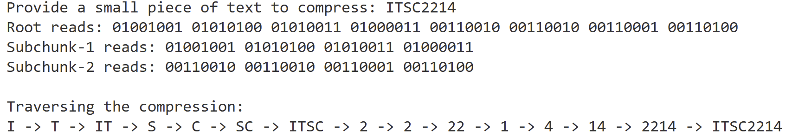

# Reflection on Project 1: Recursive Structure Engine
## What type of hierarchical data does your tree represent?
For this project, I focused on creating a text compressor that utilizes a Binary Tree. Compressed text can be hierarchical because the original message can be placed at a root and split into chunks of text in lower nodes.

## How is your tree structure organized?
The Nodes are used to represent chunks of a compressed message, and contain binary versions of the associated characters/content. They are also named to represent when traversal to them goes left or right direction in each depth level. Their children, left and right, represent the next chunks created by splitting the said content. These nodes cannot be used to represent empty text (""). Leaf nodes only contain one character in the entire message, the lowest possible result of splitting text in two.

The Binary Tree keeps track of each chunk node, and the subchunks made by splitting the text further and further. It starts at the root, which is named "message.txt" and contains the original message. From here, it create the chunks by splitting the text in halves and creating nodes for each half. It allows getting the content of a specific node in the compression tree or traversing it in post-order.

## How is recursion used in your program?
Recursion is used in three methods in the project. First, to create a tree given a user-specified image. This is because the process of splitting text and creating two associated nodes needs to repeated at multiple levels of depth for longer messages. Second, to get a specific node's content, as finding the node we want can require traveling through many levels of depth and checking if the name matches. And third, to traverse the entire tree, for much the same reasoning as the other two cases.

## Which operations does your program support?
Compressing a message through a binary tree, getting a specific compressed chunk from that tree, and traversing the tree in post-order.

## A brief comparison of recursive and iterative approaches for one task.
I did not use iteration in my project, for the main reason that using recursion can often reduce the length of the code. At least in my case, I feel that it did, as my get() and post_order() methods happened to be a few lines only.

## Example Output
The following example shows the user compressing the message, 'ITSC2214'.

